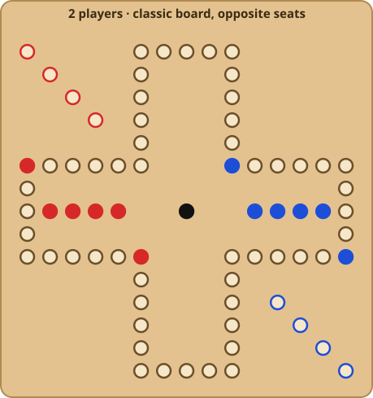
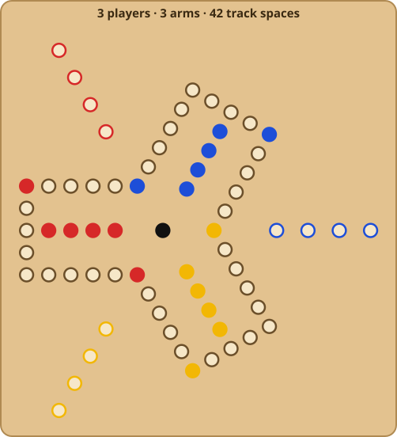
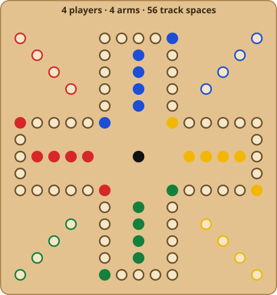
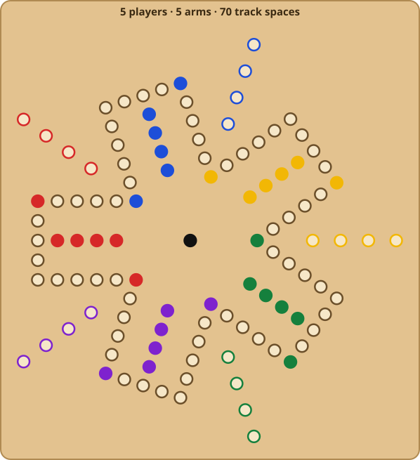
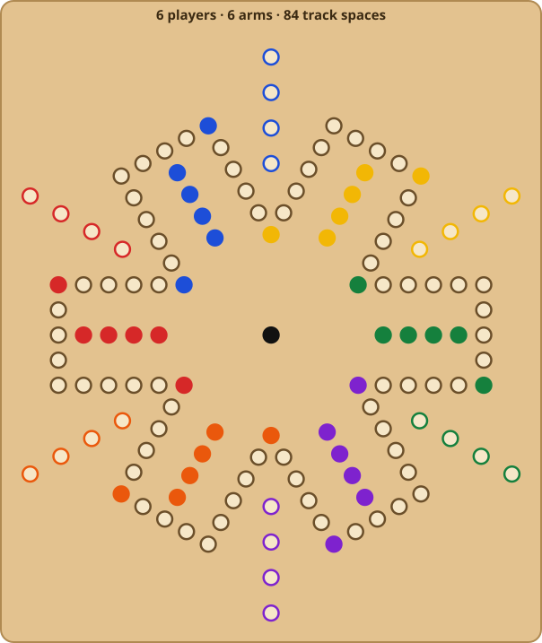
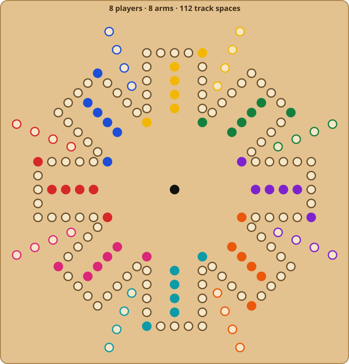

# Marbles — Design & Implementation Plan

This is the working map for building the digital version of Marbles. The rules themselves live in the [README](../README.md) and in Kelsey's `Marbles Game How to Play.docx`. This doc covers:

- The tech choice and architecture
- How the game scales to different player counts
- The phone experience (camera, zoom, moving marbles)
- AI personalities
- Online play, chat and voice
- Rule decisions and the questions still open
- Hosting on **marbls.co**
- The order to build things in

---

## 1. Tech choice: Godot

**Godot is a game engine.** It is not a language or a library. You get:

- **An editor app** (Windows/macOS/Linux) where you build *scenes*: trees of *nodes* such as a board, a hole or a marble. They are saved as `.tscn` files.
- **A runtime** written in C++ that runs those scenes on each target platform.
- **A scripting language, GDScript.** It looks like Python and supports optional static typing. Godot also supports C# and C++ (via GDExtension).

It's free and open source (MIT license), with no royalties and no splash-screen requirement. The current stable release is **Godot 4.7**.

### Does it cover web + iOS + Android "natively"?

Yes, from a single codebase:

| Target | What Godot produces | What you need |
| --- | --- | --- |
| Web | WebAssembly + WebGL 2 build (an `index.html` plus `.wasm`/`.pck`) | Any static host. Use the **single-threaded** web export so you don't need special COOP/COEP server headers. |
| iOS | A native Xcode project that compiles to a real `.ipa` | A Mac with Xcode (or a macOS CI runner), and an Apple Developer account ($99/yr) |
| Android | A native `.apk`/`.aab` built through Gradle | The Android SDK/JDK, and a Google Play developer account ($25 one-time) |
| Desktop (bonus) | Native Windows/macOS/Linux executables | Nothing extra |
| Game server | A headless Linux build of the same project | A small VM or container host (see §7) |

About "native code for all platforms": the Godot engine itself is compiled to native machine code for iOS and Android, so the result is a real native app, not a web view wrapped in an app shell. Your game logic (GDScript) runs inside that native engine. If "native" meant writing three separate apps (Swift for iOS, Kotlin for Android, JS for web), that works against using Godot and roughly triples the work. The Godot approach is one game codebase, plus small platform plugins only where a store feature needs one (Game Center / Play Games, in-app purchases, haptics).

### GDScript vs C#

**Recommendation: statically typed GDScript.**

- **C# can't export to the web in Godot 4.** The official Godot 4.7 docs still say so. Web is a first-class target for us, so C# is ruled out for now.
- **Typed GDScript satisfies "prefer strong typing."** Set the project's `untyped_declaration` warning to *Error* so untyped code fails to load.
- Every exported platform supports it, and its iteration speed in the editor is the best of the three options.

### Renderer

Use the **Compatibility** renderer (OpenGL ES 3 / WebGL 2). It has the widest web and low-end mobile support, and it handles a simple 3D scene well (see §4).

---

## 2. Architecture

The key split is a **pure rules core** with no nodes and no rendering, and a **presentation layer** that only displays state and collects input. The rules core is what makes these possible:

- Unit tests for every rule
- AI opponents
- Online play, where the server runs the exact same code
- House rules toggled at runtime ("Rules are subject to change, of course. Sometimes midgame!")

```
res://
├── autoloads/
│   └── signal_bus.gd          # SignalBus: game-wide events (see below)
├── core/                      # Pure rules. RefCounted/Resource only, no Nodes.
│   ├── cards/                 # CardRank (enum), Card, Deck, DeckRecipe
│   ├── board/                 # BoardTopology, TrackPosition, SeatLayout
│   ├── rules/                 # RuleSet (Resource), MoveGenerator, MoveResolver
│   ├── state/                 # GameState, PlayerState, TeamState (serializable)
│   ├── moves/                 # Move and its MoveStep parts (composition, not subclasses)
│   └── match/                 # Intents in, events out: Match, MatchEvent, MatchHost
├── net/                       # LocalMatchHost, RemoteMatchHost, wire protocol
├── players/                   # PlayerController + HumanInput / AIInput / RemoteInput
│   └── ai/                    # AIProfile, MoveEvaluator components, presets
├── board/                     # Scenes: Board, Arm, Hole, Marble, BoardCamera
├── ui/                        # Hand/deck view, HUD, menus, lobby, chat
├── server/                    # Headless entry point for the online game server
└── tests/                     # Test suites for core/ (gdUnit4 or a small built-in runner)
```

### How this maps to the CLAUDE.md rules

- **Strong typing.** Every variable, parameter and return is typed. Use enums (`CardRank`, `HoleKind`) and `class_name` types instead of strings and dictionaries.
- **Pass down, signal up.** `Game` passes `GameState` down to `Board` → `Arm` → `Hole` / `Marble`. Children emit signals upward, such as `Marble.selected` and `Hole.clicked`. Nothing reaches up with `get_parent()`.
- **SignalBus for game-wide events.** Examples: `turn_started(seat)`, `card_drawn(seat, card)`, `marble_moved(move)`, `marble_killed(victim, killer)`, `player_finished(seat)`, `game_over(winners)`, `chat_received(message)`. Sound, animation, HUD and analytics listen here. UI-local things like `Hole.clicked` stay as instance signals.
- **Composition over inheritance.**
  - A `PlayerController` *has* an input source (`HumanInput`, `AIInput` or `RemoteInput`) and does not use subclasses for player kinds.
  - An AI *has* a list of weighted `MoveEvaluator`s (§6).
  - A `Move` is a list of `MoveStep`s (advance, retreat, enter-home, swap, enter-bullseye, kill) rather than a class per card.
  - Special card behaviour comes from data on `CardRank` plus the `RuleSet`, not from `SevenCard extends Card`.
- **Custom class names.** Use `class_name` on all core types (`Card`, `Deck`, `BoardTopology`, `GameState`, `RuleSet`, `AIProfile`, ...) for editor autocomplete and type checking.
- **Solidified geometry.** `Hole.tscn`, `Marble.tscn` and one `Arm.tscn` (13 track holes, fast-track corner, finish lane, starting block) are hand-built scene files. Only the *placement* of N arms around the hub is computed, because player count genuinely varies. We could also add an editor `@tool` script that bakes `Board3.tscn` … `Board8.tscn` into real scene files so they can be hand-tweaked.

### Online-ready from day one

Online play shapes the core, so it's designed in now rather than bolted on later.

- **Intents in, events out.** The UI and AI never change `GameState` directly. They send *intents*, such as `DrawCard` or `ChooseMove(move_id)`, to a `MatchHost`. The host validates each intent with the rules core, applies it, and emits `MatchEvent`s. The presentation layer only reacts to events: it animates them and forwards them to the SignalBus.
- **One flow for every mode.** Hot-seat, vs-AI and online all use this flow.
  - `LocalMatchHost` runs the `Match` in-process for offline games.
  - `RemoteMatchHost` sends intents over a WebSocket, and the server's `LocalMatchHost` does the real work.
  - The client code is identical either way.
- **Deterministic and serializable.**
  - All randomness goes through one seeded RNG owned by the `Match`.
  - `GameState` round-trips to and from a plain dictionary/JSON.
  - This enables reconnects, replays, spectating, save/resume, and reproducing bug reports.
- **Hidden information stays on the server.** Deck order is secret, so clients only ever learn a card once it's drawn. That keeps cheating out, even though the family tradition says otherwise.

### Board model: topology vs layout

The rules core never works with screen positions. It sees a graph:

- **Main track:** a ring of `14 × arms` spaces. Each arm contributes 4 side + 5 end + 4 side + 1 corner.
- For seat `s` (with arm index `a`), counting clockwise from 0 at the start of the ring:
  - Starting Exit = `14a`
  - Home Base entrance = `14a − 2`
  - The seat's own Fast Track corner = `14a − 9`
- **Fast Track ring:** the `arms` corner spaces.
- **Bull's Eye:** one center node.
- Per seat: a **Starting Block** (4 slots) and a **Home Base** (4 slots).

The *layout* (`SeatLayout`) maps those nodes to positions on screen. That's the only part that changes when the number of arms changes.

---

## 3. Player counts

Four stays the default. The model separates two numbers:

- **arm count:** the board shape, one arm per possible seat
- **seat count:** how many people are playing

Every seat needs an arm, but an arm can be empty. An empty arm is still main track, it just has no start, home or colors.

Each arm adds 14 track spaces, so every marble travels further on bigger boards (about 14 × arms − 2 spaces for a full lap). Bigger boards mean longer games. That's covered under "Tuning" below.

| Players | Board | Track spaces | Team options | Notes |
| :---: | --- | :---: | --- | --- |
| **2** | Classic 4-arm, seats opposite | 56 | 1v1, or "doubles" (each person plays two colors) | A 2-arm board has no hub, so the Fast Track and Bull's Eye don't work. Reuse the classic board. |
| **3** | 3-arm triangle (alt: classic board with one empty arm) | 42 | Free-for-all | The triangle keeps it tight and fair. The empty-arm version gives the seat after the gap a free lane. |
| **4** | Classic 4-arm (default) | 56 | Free-for-all or 2v2 (partners opposite) | Exactly the physical board. |
| **5** | 5-arm pentagon (alt: 6-arm with one empty) | 70 | Free-for-all | |
| **6** | 6-arm hexagon (same idea as the six-player Aggravation board) | 84 | Free-for-all, 3 teams of 2, or 2 teams of 3 | Partners sit alternating or opposite. |
| **7–8** | 7- or 8-arm board | 98–112 | 8: 4 teams of 2, or 2 teams of 4 | The biggest test of the phone camera (§4). |

Sketches (generated by [`docs/images/generate_boards.py`](images/generate_boards.py) using the layout rules above; filled holes are Starting Exits, Fast Track corners and Home Base rows, and outlined colored holes are Starting Blocks):

| | | |
| :---: | :---: | :---: |
|  |  |  |
|  |  |  |

### Rules that need to scale

- **Fast Track.** It rides the ring of `arms` corners. On big boards it saves far more distance, so it becomes more powerful. That's probably fun, but watch it in playtesting.
- **Bull's Eye.** Unchanged: exit to your own Fast Track corner.
- **Teams.** The `RuleSet` defines teams as lists of seats. "Your partner's cards move your marbles once you finish" generalizes to "any teammate who has finished."
- **Seven split with a teammate.** Allowed by the docx. This also generalizes to any teammate.

### Tuning ideas for long games (not needed for v1)

- Shorter arms on 6+ boards. The catch: the Home Base row is 4 holes because there are 4 marbles, so shortening an arm means fewer marbles too.
- A "speed" `RuleSet` preset: 3 marbles per player, and the 4 card moves back 5.
- Turn timers, auto-play when only one move is legal, and fast-forward animations.

---

## 4. Phone experience: camera, zoom, 2D vs 3D

The hardest screen is an 8-player board on a phone in portrait. If the camera does most of the work, the player rarely has to pinch at all.

### Recommendation: a 3D board with a tilted camera

The rules core doesn't care how the board is drawn, so this only affects the presentation layer.

| | 2D top-down | 3D, tilted camera (recommended) |
| --- | --- | --- |
| Big boards on phones | Every hole is the same size, so an 8-arm board shrinks to specks; you depend on pinch-zoom | Perspective makes *your* side of the board large and the far side small. That's natural focus, without zooming. |
| Camera moves | Zoom/pan only; feels flat | Smooth dolly, tilt and orbit moves. "Fly to the action" feels like leaning over a real board. |
| Look and feel | Clean, but reads as a diagram | Wooden board, glassy marbles, soft shadows. Closer to the physical game people love. |
| Art cost | Lowest | Moderate. The shapes are simple: a board slab, spheres and hole decals. No characters or animation rigs. |
| Web/low-end performance | Trivial | Fine for a scene this simple on the Compatibility renderer. Holes and marbles are instanced, with baked lighting. |
| Tap targets | Easy | Easy, via raycast from the tap, plus the snapping described in §5 |

A top-down **"Classic view"** remains available as a camera preset over the same 3D scene. It costs almost nothing, and some players will prefer it.

### Your seat is always at the bottom

The board rotates so every player sees their own arm nearest to them, just like sitting at the real table. Online, each client does its own rotation.

### An automatic camera, with manual override

`BoardCamera` moves between a few named framings with smooth transitions:

| Framing | When | What it shows |
| --- | --- | --- |
| **Overview** | Game start, and between rounds | The whole board, tilted |
| **My turn** | When your turn starts | Your marbles plus everywhere the drawn card could take them |
| **Selecting** | You tapped a marble | That marble, its path and its possible destinations, pulled in close |
| **Follow** | Any marble moves | Tracks the moving marble; lingers briefly on a kill |
| **Watching** | Opponents' turns | A wider shot of whoever is moving |

- Pinch-zoom, drag-pan and two-finger rotate always work. Any manual gesture pauses the auto-camera until you tap **Recenter**, or until your next turn starts.
- "Auto camera" is a setting: on, only on my turn, or off.
- Tablets, desktop and landscape start from a wider framing, since the whole board fits comfortably.

### Other aids on small screens

- **Path preview.** When you select a marble, show numbered steps along its path so counting is visible.
- **Kill preview.** Highlight any marble that a move would land on before you commit.
- **Player ring HUD.** Around the screen edge, each seat gets an avatar with cards left in its deck, marbles home, and whose turn it is. Tapping one pans the camera to that player's arm.
- **Minimap.** A small full-board inset during close framings, tappable to jump.
- **Haptics.** A small tick per hole as a marble moves, and a thud on a kill.

---

## 5. Moving marbles and assist levels

Assist level is a per-player setting, so a grandparent on Guided and a cousin on Classic can sit at the same table.

| Level | What the game shows | How you move | What happens on a mistake |
| --- | --- | --- | --- |
| **Guided** | Movable marbles glow; each marble's destination is shown as a ghost marble | Tap a ghost marble (one tap) | Mistakes aren't possible |
| **Standard** | Movable marbles glow; no destinations shown | Tap a marble, then tap its destination hole | The marble shakes and stays put. Try again. |
| **Classic** | Nothing highlighted: count it yourself, like the real board | Tap a marble, then tap its destination hole (or step-count, below) | Configurable per table (below) |

On a phone, moving never requires drag precision. Dragging is supported on large screens, but taps are the main input.

- **Big invisible hit areas.** A tap snaps to the nearest *hole on that marble's path*, not the nearest hole on the board. Holes are small; hit areas are about 44 pt.
- **Step-count mode (Classic, optional).** After selecting a marble, each tap anywhere (or a swipe along the track) advances a ghost marble one hole with a haptic tick. Tap **Place** to commit. This is counting out holes with your finger, like the physical game, and it's easy one-handed on a phone.
- **What a Classic-mode mistake costs** is a `RuleSet` option:
  - *Soft:* rejected, try again. This is the default.
  - *Strict:* a miscount forfeits the card.
  - *Case Family Rules* (a fun option; the README says they're born cheaters): the miscount is **allowed**, and until the next card is drawn any opponent can tap **Challenge!** A correct challenge sends the cheating marble back; a wrong challenge costs the challenger. This fits online play well, needs a little extra event plumbing, and is a very on-brand feature.

---

## 6. AI players

AIs are built from **weighted evaluators**, not hard-coded personalities. That's composition again:

- An `AIProfile` resource holds trait sliders, from 0 to 1.
- Each trait drives one or more `MoveEvaluator` components.
- Every legal move gets a score of Σ weight × evaluator score, and the AI picks the best, with a little noise.
- Presets are just saved profiles, and players can create and name their own. "Uncle Cameron" is one slider tweak away.

| Trait | Evaluator | What it rewards |
| --- | --- | --- |
| **Aggression** | `KillEvaluator` | Landing on opponents. Extra for killing the leader, or a marble that's close to home. |
| **Goal focus** | `ProgressEvaluator` | Distance gained toward Home Base, getting marbles into Home Base, and using the Fast Track well |
| **Caution** | `SafetyEvaluator` | Ending out of reach of opponents (weighted by how likely their next cards are to hit you), staying off others' Starting Exits, and keeping marbles in safe spots |
| **Foresight** | `LookaheadEvaluator` | Looking 1–3 cards ahead over *your own remaining deck*: "I still have two 4s left, so park just past my Starting Exit." Card counting comes for free here, because the AI knows which of its cards are already played. |
| **Memory** | (modifies Foresight) | How accurately it remembers played cards. At 1.0 it counts perfectly; lower values blur the counts ("vaguely aware"). |
| **Teamwork** | `TeamEvaluator` | Protecting and advancing teammates; not killing a partner when there's a choice |
| **Gambler** | `RiskEvaluator` | Taking the Bull's Eye and Fast Track gambles |
| **Sloppiness** | (noise) | Random error that makes easier opponents feel human |

**Presets** (names from family lore; easy to change):

| Preset | Plays like |
| --- | --- |
| **Jordan** | Aggression 1.0, Goal focus 0.1. Kills whenever it can, even when that doesn't help win. No one is safe. |
| **Kelsey** | Goal focus 0.9, Aggression 0.7. Evil and smart: strategic kills that still move toward the goal. |
| **The Turtle** | Caution 1.0, Aggression 0.2. Stays safe, avoids risk, and wins slowly. |
| **The Grandmaster** | Foresight 3 cards, Memory 0.9, balanced otherwise. Plays like chess and plans around what's left in its deck. |
| **Rookie** | Balanced, with high Sloppiness. Good for kids and first-timers. |

AIs only see **public information plus their own deck history**, exactly what a person at the table could know. They never peek at deck order. The server runs them too: an AI can fill an empty online seat, or take over for someone who disconnects.

AI-vs-AI simulation also becomes a balancing tool. Run thousands of headless games to check fairness across seats, board sizes and rule variants.

---

## 7. Online play, chat and voice

### Recommended stack

| Piece | Choice | Why |
| --- | --- | --- |
| **Game server** | A **headless Godot build of this same project**, running the `Match` authoritatively | One rules implementation for client, server and AI. No rewriting rules in another language, and no drift between them. |
| **Transport** | **WebSocket over TLS** (`wss://play.marbls.co`) | Works identically in browsers, iOS and Android. A turn-based game doesn't need UDP. |
| **Accounts, profiles, stats, friends** | **Supabase** (Auth + Postgres) | Hosted, with a generous free tier, and it's already connected to this workspace. Game servers verify the player's Supabase login token when they connect. |
| **Server hosting** | One small container or VM to start (e.g. Fly.io, Hetzner or Railway) | One process can host many games. Scale out later with a tiny matchmaker. |

The alternative is an all-in-one game backend such as **Nakama**, which bundles matchmaking, chat and accounts. It's a good product, but we'd still run our rules in Godot, so it adds a second big system to learn. Revisit it if we outgrow the simple setup.

### What the server handles

- **Lobbies:** create a table, share an invite link (`marbls.co/t/ABCD`), then choose seats, teams, AIs, the `RuleSet`, board size and assist levels.
- **Quick match** with strangers (later).
- **Reconnects:** the full `GameState` is re-sent on reconnect. A disconnected seat is covered by an AI after a timeout.
- **Turn timers,** configurable per table.
- **Spectators and replays,** straight from the event log.
- **Async games (worth considering):** long 6–8 player games are easier if people can take turns hours apart, with a push notification when it's your turn. Deterministic, serializable state makes this mostly a hosting decision.

### Chat

- Text chat goes over the same game socket, with quick reactions (😈 💀 😭 🎯) and a few preset taunts. One-tap taunts matter a lot on phones.
- It needs mute and block, a profanity filter toggle, and a report button. **The app stores require these** for apps with user-to-user chat.

### Voice (later)

- Voice uses WebRTC. Browsers have it built in; on iOS and Android, Godot needs a WebRTC plugin.
- The practical route is probably a hosted voice service (LiveKit or similar) instead of running our own relay servers. We'd connect it through a small native plugin on mobile and the browser's JavaScript bridge on web.
- Keep it opt-in, push-to-talk by default, and limited to friends/party tables.
- It's the last online feature to build, after text chat has proven the social loop.

---

## 8. Rules: decisions and open questions

### Decided

| Question | Decision |
| --- | --- |
| Leaving the Bull's Eye | **Jack, Queen or King.** (The docx table's Queen/King-only line is superseded.) |
| Fast Track use-it-or-lose-it | **The very next card.** If that card doesn't move the Fast Track marble, the chance is lost and it goes the long way. |
| Deck composition | **52 cards + 2 Jokers per player.** |

### Idea: the Comeback Joker

After a player loses N games in a row, their deck gets an extra Joker until they win.

- It's a `RuleSet` option (`comeback_joker_after_losses`, 0 = off) plus a `DeckRecipe` that can add cards.
- It needs a persistent win/loss streak per player. That comes from accounts online, or from saved local profiles for hot-seat play.
- Show it openly (a 🃏 badge by the player's name), so it reads as a friendly handicap, not a secret one.
- Open decisions:
  - Is it per-table or per-player-lifetime?
  - Does it stack (a third Joker after 2N losses)?
  - Do AIs count as opponents for the streak?

### Still open

Each answer becomes a `RuleSet` field with a default, so house-rule variants cost nothing later.

1. **Cutting for first player.** How does a Joker rank, and how are ties broken?
2. **Fast Track movement.** Does each hop between corners cost 1 point of movement? Can one card carry a marble around the Fast Track *and then* along the main track?
3. **Jack swap.** Can you swap with marbles on the Fast Track, in the Bull's Eye, or on someone's Starting Exit? With a teammate's marble? Does a swap count as a kill? (Presumably no.) Does a Jack that *swaps* a marble onto a Fast Track corner start a Fast Track chance?
4. **Home Base.** Is an exact count required to enter or move within it? Can a marble jump over its own marbles there? (The "never hop your own color" rule suggests no.)
5. **Play-again with no legal move.** If you draw an Ace but no move is possible, do you still draw again? (Presumably yes.)
6. **Kills.** Can you kill a marble sitting on its own Starting Exit? Can you kill in the Bull's Eye?
7. **Four backwards.** Can a 4 move a marble backwards *out of* the Fast Track or Bull's Eye, or only *into* them?
8. **Seven split.** Can the two halves kill? Can one half go into the Home Base?

---

## 9. Hosting on marbls.co

| Address | What | Where |
| --- | --- | --- |
| `marbls.co` | The web game (static Godot web export), plus a small landing page with store badges | GitHub Pages or Cloudflare Pages, deployed by CI on every merge to `master` |
| `play.marbls.co` | WebSocket game server | The container host from §7 |
| `marbls.co/t/<code>` | Table invite links | The web app handles them. On phones, universal/app links open the installed app instead. |

---

## 10. Roadmap

Each milestone ends with something playable or testable.

0. **Project setup.**
   - Godot 4.7 project with the Compatibility renderer, typed-GDScript warnings set to errors, and the `SignalBus` autoload.
   - A test runner, and CI on GitHub Actions running headless tests on every PR.
1. **Rules core, classic 4-player.**
   - `Card`, `Deck`, `BoardTopology`, `GameState`, `MoveGenerator`, `MoveResolver`, `Match`, and `LocalMatchHost` (intents in, events out).
   - Basic movement, starting, kills, Home Base, and play-again.
   - Full unit tests, and seeded, serializable state. No UI yet.
2. **Hot-seat prototype.**
   - A 3D board built from `Arm`/`Hole`/`Marble` scenes, with the tilted `BoardCamera`, tap-to-move, and Guided and Standard assist levels. Placeholder art.
   - First human playtest, plus the first web deploy to marbls.co so the family can try it.
3. **Special rules.** Four (backwards), Seven split, Jack swap, Fast Track, Bull's Eye, and teams.
4. **AI opponents.** Evaluators, `AIProfile`, the presets, and a headless AI-vs-AI simulation for balance.
5. **Variable player count.** `SeatLayout` for 3–8 arms, the lobby/seat/team picker, and full auto-camera polish on phones.
6. **Online play.**
   - Headless server, `RemoteMatchHost`, Supabase accounts, invite links, reconnects, and AI takeover.
   - Text chat and reactions.
7. **Mobile release.** Android (`.aab`) then iOS. Icons, safe areas, haptics, store listings, privacy policy, and chat moderation tools.
8. **Later:** Classic assist level with step-count, Case Family Rules, the Comeback Joker, async games, and voice chat.
